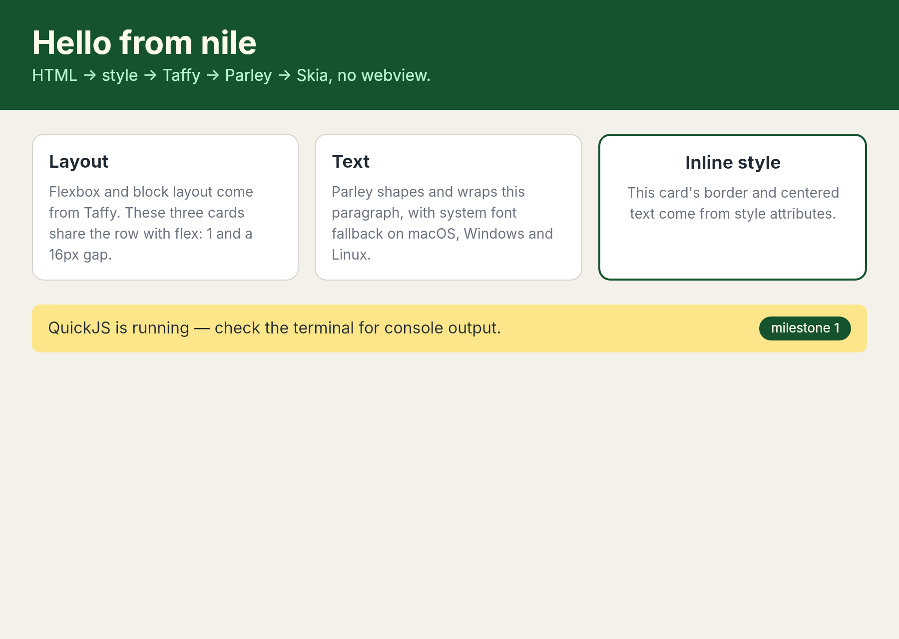
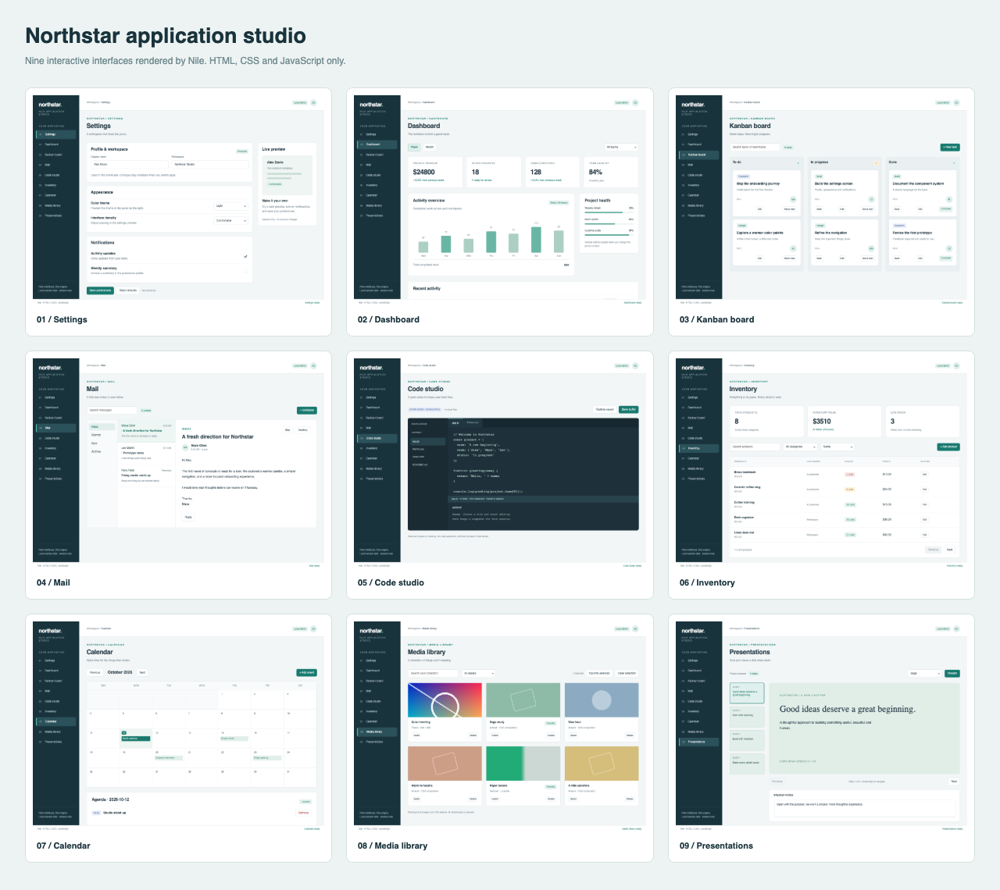

# nile

An open-source, embeddable HTML/CSS/JS UI engine in Rust, in the spirit of
[Sciter](https://sciter.com): its own renderer, no webview, small enough to
ship inside a desktop app.

*"nile" is a working title.*

**New to Nile?** Start with the [usage guide](docs/guide/README.md) and
[your first app](docs/guide/getting-started.md). The guide covers layout, scripting,
controls, selection, custom menus, native windows, embedding and the snapshot CLI.



## Status: milestone 1

The full pipeline runs end to end:

```
HTML ──html5ever──▶ DOM ──cascade──▶ computed styles ──Taffy + Parley──▶ boxes ──Skia──▶ pixels
                     │
                     └──▶ <script> ──▶ QuickJS
```

| Crate | Job | Built on |
|---|---|---|
| `nile-dom` | Arena DOM, HTML parsing | `html5ever` |
| `nile-style` | CSS parsing, cascade, inheritance, UA sheet | `cssparser` |
| `nile-text` | Shaping, line breaking, font fallback | `parley` |
| `nile-layout` | Block + flex layout, text measurement | `taffy` |
| `nile-render` | Backgrounds, borders, radii, glyphs | `skia-safe` |
| `nile-script` | JS runtime, DOM bridge, events, modules and JSX | `rquickjs` |
| `nile-engine` | The page without a window: input, forms, scrolling, painting into a buffer | |
| `nile-shell` | The `nile` binary: native window around the engine, headless PNG | `winit`, `softbuffer` |
| `nile-capi` | C library (`libnile`) and `nile.h` for embedding | `cbindgen` |
| `nile-extension-sdk` / `nile-extensions` / `nile-extension-pack` | Native extension C ABI, the host that loads and dispatches to extension libraries, and the packed-app cache | `libloading` |

## Embedding (C API)

`cargo build -p nile-capi --release` produces `libnile` (a shared and a static library) and
`crates/nile-capi/include/nile.h`. The host owns the window and the event loop: create a view
(`nile_view_create_html` / `nile_view_create_file`), forward pointer, wheel and key events
(`nile_pointer_move`, `nile_pointer_button`, `nile_wheel`, `nile_key`, `nile_text_input`), call
`nile_view_tick` when its `next_ms` elapses, and draw with `nile_view_render` into your own
BGRA buffer. The page talks back through `nile_view_take_window_command` (close, minimize,
maximize, move, resize, fullscreen), `nile_view_title`, `nile_view_cursor`,
`nile_view_window_config` (the `window-*` attributes) and `nile_view_caption_press` (frameless
dragging). Input methods (IME): the host enables its IME while `nile_view_ime_wanted` is 1, puts the candidate window at `nile_view_ime_cursor_area`, and forwards `nile_view_ime_preedit` / `nile_view_ime_commit` / `nile_view_ime_cancel`; the `nile` binary does this through winit's `Ime` events. The composition shows underlined at the caret in text inputs and in `contenteditable` hosts (`--compose TEXT` renders one headless; `examples/ime.html`). Scripts and host call each other: `nile_view_eval`, `nile_view_call`,
`nile_view_register_function` (scripts see it as `host.name(...)`, JSON in and out) and
`nile_view_take_console`. The clipboard is yours through `nile_view_set_clipboard` (text, optionally HTML), native dialogs through `nile_view_set_dialogs`, file drops through `nile_view_drop_files`, and popups with their own OS windows through `nile_view_portals`/`nile_view_render_portal`.
A program that doesn't want to write window code links `libnile_app` instead, which adds `nile_run`/`nile_run_file`/`nile_run_html` (windows and the event loop; `examples/c/app.c`). Single-threaded; no panic crosses the boundary. See `examples/c/render.c` for a complete program
that renders a page to an image:

```sh
cargo build -p nile-capi --release
cc examples/c/render.c -Icrates/nile-capi/include -Ltarget/release -lnile -Wl,-rpath,$PWD/target/release -o render
./render examples/hello.html out.ppm
```

Not in the C API yet: multiple mouse buttons, touch, GPU surfaces (it paints
into CPU memory), drag and drop, and a stable ABI version check beyond `nile_version()`.

## Running it

Requires recent stable Rust. On macOS you also need the Xcode command line
tools (`xcode-select --install`). The first build downloads prebuilt Skia
binaries from GitHub (macOS arm64/x86_64, Windows, Linux).

```sh
cargo run -p nile-shell -- examples/hello.html      # window: F5 or Ctrl/Cmd+R reloads, wheel scrolls
cargo run -p nile-shell -- examples/hello.html --png out.png --scale 2
cargo run -p nile-shell -- examples/interact.html --png out.png --hover 40,40   # simulate the pointer
cargo run -p nile-shell -- examples/scripting.html --png out.png --click 60,80 --wait 400   # click, run timers
cargo run -p nile-shell -- examples/measure.html --png out.png                              # layout queries from JS
cargo run -p nile-shell -- examples/todo/index.html --png out.png --click 60,128          # modules + JSX + Sciter helpers
cargo run -p nile-shell -- examples/forms.html --png out.png --click 60,66 --type "Ada{Backspace}x"   # form controls
cargo run -p nile-shell -- examples/scrolling.html --png out.png --wheel 100,100,-60                    # element scrolling
cargo run -p nile-shell -- examples/forms.html --png out.png --click 60,66 --type "Ada{Home}{Shift+End}{Cmd+c}"   # selection
cargo test --workspace
```

## Native extensions

Separately distributed native packages can expose asynchronous operations, binary
buffers, managed resources and ongoing events. SQLite is the first independent
consumer; it is not linked into the engine.

```sh
python3 scripts/build-extension.py sqlite --dest examples/sqlite/extensions/sqlite
cargo run -p nile-shell -- examples/sqlite/index.html
```

See the [extension author and JavaScript guide](docs/extensions.md) for the C ABI,
threading/ownership contract, platform packages and standalone builds. Native
packages are trusted process-level code. Packed native files use a private, verified
cache; wrappers stay archived. See the guide for explicit external-library mode,
platform signing requirements and stable writable application-data paths. An
application opts in with a `nile.json` next to its pages (the nearest one above a page
is used, never one at the filesystem root or in or above the home folder).

## Admin registration demo

```sh
cargo run -p nile-shell -- examples/register.html
```

Click Register to open the form in a tool window owned by the launcher. Clicking
Register again focuses the existing form; after closing it, the button opens a
new one.

A screenshot-inspired registration window with a custom title bar, password and
email fields, and one serial-number input enhanced through CSS `prototype:`
([SerialNumber](examples/prototype/serial-number.js)). It formats six groups of
four characters while preserving native text selection and clipboard support.
Change Serial clears the key; Get Serial
fills a sample key; Activate validates the fields locally. This example does not
connect to a licensing service or save credentials.

## POS interface demo

```sh
cargo run -p nile-shell -- examples/pos/index.html
```

A retail counter with product search, categories, a cart, discounts, held sales,
checkout and receipts. Uses sample data in memory; see [the example instructions](examples/pos/README.md).

## Virtual data grid demo

```sh
cargo run -p nile-shell -- examples/virtual-grid/index.html
```

A grid of up to one million rows and 100 columns with virtualization on both
axes, keyboard navigation and cell editing. Only the visible slice is mounted.
See [the implementation walkthrough](examples/virtual-grid/README.md).

## File explorer demo

```sh
cargo run -p nile-shell -- examples/file-explorer/index.html
```

A real folder browser using `@sys`: expandable folder tree, sortable file list,
text previews, filtering, navigation history, context menus and resizable panes.
See [the example's instructions](examples/file-explorer/README.md).

## Word-style ribbon demo

```sh
cargo run -p nile-shell -- examples/word-ribbon.html
cargo run -p nile-shell -- examples/word-ribbon.html --png docs/word-ribbon.png --width 1280 --height 900 --scale 2
```

A ribbon around a live `contenteditable` document. Font, style and alignment
commands act on the selection; lists, clipboard commands, undo/redo, search, word
count and table insertion work too. Toolbar buttons preserve the editor's caret.
Save/AutoSave, sharing and printing remain demo controls; the page-break command
uses `insertPageBreak` (visible in Print layout). See the [rich-text editing guide](docs/guide/rich-text-editing.md)
for usage, supported commands and current limits.

## Desktop application showcase

For an editable Excel-style grid with formulas, two worksheets, cell formatting
and local saving, run:

```sh
cargo run -p nile-shell -- examples/excel/index.html
```

See the [spreadsheet guide](examples/excel/README.md) for supported calculations,
keyboard controls and limits.

```sh
cargo run -p nile-shell -- examples/workbench/index.html
```

Nine interactive interfaces with shared navigation: settings, dashboard, kanban,
mail, code studio, inventory, calendar, media library and presentations. They use
existing HTML/CSS/JS APIs and in-memory sample data. See
[the showcase guide](examples/workbench/README.md) for workflows and validation.



## Optional system appearance

Load [the external system theme](themes/system/README.md) to apply platform-specific
control and component styling, including hover/pressed/focus states. The package
is optional and separate from the engine.

```sh
cargo run -p nile-shell -- examples/system-theme/index.html
```

## Documentation

Start with the [user guide](docs/guide/README.md). The
[complete feature reference](docs/reference/README.md) covers CSS, DOM/events,
web APIs, built-in modules, windows, editing, embedding and runnable examples.
What changed and when is in the [changelog](CHANGELOG.md).

## What's supported today

- **Selectors** (Servo's `selectors` crate): type, `.class`, `#id`, attributes (`[a]`, `[a^=b]`, ...), the
  descendant / `>` / `+` / `~` combinators, `:first-child`, `:last-child`, `:nth-child()`, `:not()`, `:is()`,
  `:root`, `:empty`, and `:hover` / `:active` / `:focus` (driven by pointer and focus events).
  `:link`, `:any-link` and `:visited` work (following an `<a href>` marks it visited for the life of the page, `el.state.visited` sets it). Rules with unsupported selectors (`::first-line`, ...) are dropped.
- **Overflow and scrolling:** `overflow` / `overflow-x` / `overflow-y` (`hidden` clips to the padding box; `auto` and
  `scroll` also scroll with the wheel, with scroll chaining to the page, and draw overlay scrollbars). Hit testing,
  hover and `getBoundingClientRect` follow scrolled content; `scrollTop`/`scrollLeft`/`scrollWidth`/`scrollHeight`,
  `scrollTo`/`scrollBy` and `scroll` events work on elements (see `examples/scrolling.html`). Inputs and textareas
  scroll to keep the caret visible.
- **Properties:** `display` (block, inline, inline-block, flex, grid, none), `box-sizing`, `width/height` + min/max, `margin`, `padding`,
  `border`, `border-radius`, `background(-color)`, `color`, `font-size/weight/family`,
  `line-height`, `text-align`, `white-space` (`nowrap`), `font-style`, `text-decoration` (underline, line-through), `flex`, `flex-direction/wrap/grow/shrink/basis`,
  `justify-content`, `align-items`, `gap`.
- **JavaScript DOM** (QuickJS): `document`, `Element`/`Node`/`Text`, `querySelector(All)`, `matches`, `closest`,
  `classList`, `style`, `dataset`, attributes, `innerHTML`/`textContent`, `createElement`, tree edits,
  `addEventListener` with capture/bubble/once, `on*` properties and attributes, `click`/`mouse*`/`key*`/`focus`
  events, `DOMContentLoaded`/`load`, timers, `requestAnimationFrame`, promises, `<script src>` (see
  `examples/scripting.html`). Layout queries: `getBoundingClientRect`, `offset*`/`client*`, `getComputedStyle`
  (common properties), `innerWidth/Height`, `scrollTo`/`scrollY`/`scrollIntoView` (see `examples/measure.html`).
- **Web platform:** `fetch` (`Headers`, `Request`, `Response`, `AbortController`) and `XMLHttpRequest` load files next
  to the page and `data:` URLs, and http(s) when the `net` feature of `nile-engine` is on (the `nile` binary has it;
  `nile-capi` needs `--features net`); requests run on worker threads, so the page never blocks
  (`examples/fetch.html`). Also `MutationObserver`, `URL`/`URLSearchParams`, `sessionStorage` (in memory) and `localStorage` (saved as JSON in the user's data
  directory, one file per page file; `NILE_STORAGE_DIR` moves it or `off` disables it, `Page::set_storage_file` / `nile_view_set_storage_file` choose a file), `matchMedia`, `ResizeObserver` and `IntersectionObserver` (checked after each layout change or scroll; `rootMargin` is ignored), `window.location` (the page's `file://` URL; only `hash` changes take effect), `history.pushState`/`replaceState` (no back/forward), `navigator`, `devicePixelRatio`, `structuredClone`, `atob`/`btoa` and `TextEncoder`/`TextDecoder`.
- **Built-in modules:** `import … from "@nile"` (`"@sciter"` is an alias, so Sciter apps keep working) (`on`/`off`/`once`, `$`/`$$`, `uuid`, `encode`/`decode`, `toBase64`/`fromBase64`, `md5`, `crc32`, `parseValue` (JSON++), `devicePixels`, `onGlobalEvent` as window events) and `"@env"` (`OS`, `PLATFORM`, `DEVICE`, `language`, `country`, `userName`, `machineName`, `domainName`, `arguments`, `launch`, `home`/`homeURL`, `path`/`pathURL`, `drives`, `variable`, `exec`), verified against docs.sciter.com/docs/JS.runtime; `examples/nile-modules.html`. `launch` and `exec` run programs, so don't load untrusted pages into an embedder that doesn't want that.
- **Modules and JSX:** `<script type="module">` and `import` of relative files (`./x.js`, `../y.jsx`). JSX in any
  script compiles like Sciter's: `<h1 id="a">Hi</h1>` becomes `JSX("h1", {id: "a"}, ["Hi"])`, which returns a
  vnode array `[tag, attrs, children]`. `append`/`prepend`/`content` render vnodes (strings, nodes and arrays
  too), `patch(vnode, onlyChildren)` reconciles existing DOM, and function components are called as
  `Component(props, kids, parent)`. Replace `globalThis.JSX` to change what JSX means. See `examples/todo/`.
- **Sciter-style helpers** (checked against docs.sciter.com): `$()`/`$$()` (also `el.$`, `el.$$`),
  `el.on("click.ns ^keydown", [selector], handler)` where `handler(evt, matched)` runs with `this` = the element
  it is attached to, `el.once()`, `el.off(name | ".ns" | handler)`, `el.state` flags (`hover`/`active`/`focus`
  from interaction; `checked`, `disabled`, `readonly`, `expanded`, `collapsed`, `current`, `selected`, `invalid`,
  `busy` are runtime flags matched by the same-named `:pseudo-classes`), `elementIndex`, `nodeIndex`,
  `insertAfter`.
- **`<canvas>`:** the Canvas 2D context over a Skia surface (paths, `Path2D`, gradients, patterns, shadows, text, `drawImage`, `getImageData`/`putImageData`, `toDataURL`, compositing, `OffscreenCanvas`), `new Image()` and `` `onload`; no WebGL or `ImageBitmap` ([guide](docs/guide/canvas.md), `examples/canvas.html`).
- **Form controls:** `<input>` (text, password, placeholder, `value`), `<textarea>` (wrapping, newlines, Up/Down
  by line), checkboxes and radio groups (including `<label>` clicks), `<button>`, disabled states, a blinking
  caret with click-to-place that scrolls into view, typing, Backspace/Delete/arrows/Home/End, Tab and Shift+Tab
  focus order (`tabindex` respected), and `input`/`change`/`focus`/`blur` events. Undo/redo (Ctrl/Cmd+Z, Shift+Ctrl/Cmd+Z, Ctrl+Y; typing and Backspace runs group into one step), word-wise
  movement and deletion (Alt or Ctrl+arrows/Backspace/Delete, Cmd+arrows/Backspace on macOS), and keyboard scrolling
  outside text inputs (arrows, Page Up/Down, Space, Home/End on the focused or hovered scroller, then the page).
  **Window** (`examples/window.html`): the root `<html>` element configures the native window as in Sciter
  (docs.sciter.com/docs/HTML/html-window): `window-title`, `window-width`/`-height` (px or % of the desktop),
  `window-min-*`/`-max-*`, `window-resizable` (`true`, `false` or an edge margin like `6px`),
  `window-minimizable`/`-maximizable`, `window-state` (`shown`, `minimized`, `maximized`, `full-screen`, `hidden`),
  `window-alignment` (1-9 on the numeric keypad's layout, 5 = centre), `window-icon`, and `window-frame`
  (`default`/`standard`, `extended` (macOS: content under the title bar), `solid` (no system frame), `solid-with-shadow` (no frame, the system's drop shadow on macOS and Windows; `examples/solid-shadow.html`),
  `transparent`), and Nile's `window-material` (`blur`, `acrylic`, `mica`, `tabbed`, `sidebar`, `hud`: the system's frosted backdrop behind a page with a transparent background; `examples/transparent.html`, `examples/material.html`). With no system frame, elements with `role="window-caption"` drag the window (double-click
  maximizes) and `role="window-minimize"`/`window-maximize`/`window-close` are the buttons; the edges resize it.
  Scripts get `document.title` (set and get), `window.close()`, `moveTo/moveBy/resizeTo/resizeBy`,
  `screenX/Y`, `outerWidth/Height` and `element.requestFullscreen()`/`document.exitFullscreen()`.
  **Rich-text editing** (`examples/editor.html`, and `examples/word-ribbon.html`, a working word processor): any element with `contenteditable` is an editor. Click, drag, double- and triple-click to select; type; Enter splits paragraphs and list items (Shift+Enter inserts `<br>`); Backspace/Delete (with Alt for words); arrows, Home/End, Cmd/Ctrl+arrows (Cmd = line edges on a Mac, Ctrl = words), with Shift to extend; Cmd/Ctrl+A/Z/Y/B/I/U/C/X/V. `document.execCommand` runs `bold`, `italic`, `underline`, `strikeThrough`, `subscript`, `superscript`, `foreColor`, `backColor`/`hiliteColor`, `fontName`, `fontSize`, `removeFormat`, `justify*`, `insertUnorderedList`/`insertOrderedList`, `indent`/`outdent`, `formatBlock`, `insertText`, `insertParagraph`, `insertLineBreak`, `insertHTML`, `insertImage`, `insertHorizontalRule`, `createLink`/`unlink`, `delete`, `selectAll`, `undo`/`redo`, `copy`/`cut`/`paste`; `queryCommandState`/`Value`/`Enabled`/`Supported` drive toolbars. Nile adds `fontSizePx` and `blockStyle` (`"prop: value; ..."` on the selected blocks). With a caret, a format command applies to the next typed text. `window.getSelection()` has `anchorNode`/`focusNode`/offsets, `getRangeAt`, `addRange`, `collapse`, `extend`, `setBaseAndExtent`, `selectAllChildren`, `toString`; `document.createRange()` gives a `Range` (`setStart`/`setEnd`, `selectNodeContents`, `toString`, `deleteContents`, `insertNode`). Editors fire `beforeinput` (cancelable), `input` and `selectionchange`. A `mousedown` handler that calls `preventDefault()` keeps focus and selection where they are, so toolbar buttons don't steal the caret.
  Page text selection (off by default, like a desktop UI: opt in with `user-select: text`/`all`, a `selectable` attribute, or Sciter's `behavior: htmlarea`; `text-selection-background-color` sets the highlight): drag, double-click (word), triple-click (run), Shift+click, Ctrl/Cmd+A and Ctrl/Cmd+C, with `window.getSelection().toString()`. Text selection in inputs and
  textareas: Shift+arrows/Home/End, drag, Shift+click, double-click (word), triple-click (all), Ctrl/Cmd+A, and
  copy/cut/paste through the system clipboard; Tab selects an input's contents. In JS: `selectionStart`,
  `selectionEnd`, `setSelectionRange()`, `select()`. `<select>` with `<option>`s: a drop-down that opens on click,
  Space/Enter or Alt+Down, with mouse hover, arrows/Home/End, type-ahead, Escape, disabled options, and `input`/
  `change` events; sized to its longest option; a long list scrolls (wheel, arrows) and opens upward when there is
  more room above. `<optgroup label>` headings (bold, unselectable, options indented; `examples/optgroup.html`) work in drop-downs and list boxes. `<select multiple>` and `size > 1` are list boxes drawn inline: click, drag to select a range, Cmd/Ctrl-click to toggle,
  Shift-click to extend, arrows/Page/Home/End (Shift extends), Cmd/Ctrl+A, type-ahead, wheel (see
  `examples/listbox.html`). In JS: `value`, `selectedIndex`, `selectedOptions`, `options`, `option.selected`/
  `text`/`label`/`value`, `length`. In JS: `value`, `checked`, `disabled`, `type`, `name`,
  `placeholder`, `focus()`, `blur()`, `document.activeElement` (see `examples/forms.html`).
- **Pointer interaction:** hit testing (down to the inline element under the pointer), `:hover`, `:active` and
  click-to-focus on links and form controls, restyled live (see `examples/interact.html`).
- **Inline content:** mixed text, `<br>`, inline padding/border/background/radius and `inline-block` (with
  baseline) wrap as one flow (see `examples/inline.html`, `examples/selectors.html`).
- **Cascade and values:** `!important`, custom properties with `var(--x, fallback)` (inherited, can reference each
  other), `@media` (width/height features incl. range syntax, `orientation`, `screen`, `and`/`not`/commas; re-evaluated
  when the window resizes). `calc()` (including `100% - 20px`, resolved in layout), `min()`, `max()`, `clamp()` with absolute units.
  **Units:** `px`, `em`, `rem`, `%`, `pt`, `vw`, `vh`, `vmin`, `vmax`, `cm`, `mm`, `in`, `pc`. **Colors:** hex (3/4/6/8
  digits), `rgb()/rgba()` (legacy and `r g b / a` syntax), `hsl()/hsla()`, all CSS named colors, `transparent`,
  `currentColor` (borders follow `color` by default). Borders: per-side width, color and style (`solid`, `dashed`, `dotted`) with mitred corners.
  `text-transform`, `letter-spacing`, `box-shadow` (several, blurred, spread, `inset`; `examples/inset-shadow.html`) and painted `opacity` (a layer
  over the whole subtree) and `position: relative|absolute` (against the nearest positioned ancestor), `fixed` and `sticky` (`examples/fixed.html`) with `top/right/bottom/left/inset` and `z-index` (see
  `examples/position.html`) `linear-gradient`/`radial-gradient` and their `repeating-` forms as `background`
  (`examples/gradients.html`), `transition` (any animatable property or `all`, with delay, `ease`/`linear`/`cubic-bezier()`/`steps()`; a change mid-transition continues from where it is) and `@keyframes` `animation` (with `transitionend`, `animationstart` and `animationend` events carrying `propertyName`/`animationName`/`elapsedTime`; `examples/anim-events.html`; no `transitioncancel`/`animationiteration`) (iterations, `infinite`, direction, fill modes, delays; `examples/animations.html`) over opacity, colors, lengths, padding/border widths, radius, `transform` and more, `transform` (`translate`, `scale`, `rotate`, `skew`, `matrix`, with `transform-origin`; hit testing and `getBoundingClientRect` follow it; `examples/transforms.html`), `` (PNG/JPEG/WebP/GIF from files next to the page or `data:` URLs; sized by CSS, `width`/`height` attributes or the picture) and `background-image: url()` with `background-size`/`-position`/`-repeat` (`examples/images.html`), `float`/`clear` (`examples/float.html`), `<include src media>` (fragments spliced in while loading, with fallback content; `examples/include.html`), `<frame>`/`<iframe>` (a separate document with its own scripts, scrolling, focus and input, painted into the box; `src`, `loadFile`/`loadHtml`/`loadEmpty`, `frame.document.$()`, `newdocument`/`complete`, `postMessage` both ways with `window.parent`; `content-style`; `examples/frames.html`), accessibility for screen readers (UI Automation, VoiceOver, AT-SPI through AccessKit; roles, names, states and actions from the DOM and ARIA attributes; also as JSON from the C API; see `docs/guide/accessibility.md`), `new Window({...})` and `Window.this.modal({...})` (several native windows, each its own page; messages, `close(value)`, `Window.share`, `parameters`, a Promise-returning modal; `examples/windows.html`), `Window.this.selectFile`/`selectFolder`/`modal(<alert>…)` (native open/save/folder choosers and message boxes through AppleScript, PowerShell or `zenity`/`kdialog`, or opt-in in-window message boxes with rich content, custom buttons and CSS: `<question inline>`/`Window.this.messageBoxes = "inline"`, returning a Promise; `examples/dialogs.html`), `element.popup()`/`takeOff()` with `popup-position`/`popup-animation` CSS, `title`/`tooltip` tooltips with `tooltiprequest`, and `contextmenu` with `<menu.context>` (painted in the window, or in an OS window of their own with `window: "popup"`; `examples/popups.html`), `<frameset cols|rows>` with `<splitter>`s (panes are frames or any block; drag to resize; `frameset.state`; `examples/frameset.html`), `white-space` (`normal`, `nowrap`, `pre`, `pre-wrap`, `pre-line`, with tab stops), lists (`ul`/`ol`/`li` bullets and counters, `::marker` and `list-style-position` (`examples/markers.html`), `list-style-type` incl. `decimal`, `lower-alpha`, `upper-roman`, `start`/`reversed`/`value`), `:has()`, `text-overflow: ellipsis`, `<hr>`, `<fieldset>`, `<details>`/`<summary>` (click toggles, `toggle` event), `<progress>`, `<meter>`, `<input type=range>` (drag, arrows, Home/End; `input`/`change`), `<input type=number>` (spin arrows, Up/Down by `step` within `min`/`max`, only number characters accepted; `examples/number.html`), `<input type=color>` (a swatch plus an editable hex value, normalised to `#rrggbb`), `date`/`time`/`month`/`datetime-local` (typed digits only, Up/Down steps the field under the caret, wrapping; `min`/`max`), and `<input type=file>` (a "Choose File" button; the `nile` binary opens the system chooser through AppleScript, PowerShell or `zenity`/`kdialog`; scripts see `files` with `name`/`size`/`type`/`text()`; C hosts answer `nile_view_take_file_request` with `nile_view_choose_files`; `examples/inputs.html`), `cursor` (pointer shapes, inherited; links, inputs and disabled controls have defaults), tables (`table`, row groups, `tr`, `td`/`th` with `colspan`/`rowspan`, `caption`, `border-spacing`, `border-collapse`, `vertical-align`/`valign`; `examples/tables.html`), inline `vertical-align` (`sub`, `super`, lengths; `<sub>`/`<sup>`; `examples/subsup.html`), `display: grid` (`grid-template-columns/rows` with `px`/`%`/`fr`/`auto`/`minmax()`/`repeat()` incl. `auto-fill`/`auto-fit`,
  `grid-auto-*`, `grid-column/row` with spans and line numbers, `grid-template-areas` + `grid-area`, `row-gap`/`column-gap`,
  `justify-items`/`justify-self`/`align-self`/`align-content`/`place-*`; `examples/grid.html`), and `::before`/`::after` with `content` (strings, `attr()`, quotes; any `display`, including
  inline-block and absolute; `examples/pseudo.html`) too. See `examples/css-compat.html` for a page that checks these.

## Known gaps (deliberate, for now)

- Font fallback: system fallback covers scripts (CJK, ...) but not every symbol block, so Dingbats (`✓`) and
  `⚠`-range symbols name Apple Symbols / Zapf Dingbats / Segoe UI Symbol / Noto Sans Symbols explicitly. Only
  checked on macOS; other symbol blocks may still show a missing-glyph box.
- **Inline layout is partial.** Shrink-to-fit `inline-block` uses max-content (it won't narrow to fit a
  line), inline margins are ignored, a wrapped inline's border/radius isn't sliced at the break, only the
  innermost decorated inline is painted, and block children of an inline element don't split the run.
- Window gaps: no `window-corners`, per-pixel alpha (`transparent`, materials) is
  only verified on macOS (Windows blits translucent windows itself through a DIB with alpha, `alpha_win.rs`; Wayland uses
  softbuffer's ARGB buffers; X11 has no alpha path yet, so corners stay opaque there). `Window.this.material = "mica"` changes it live; a frameless window is clipped to the root's `border-radius` (Windows: unanti-aliased region), `sidebar` is Mica on Windows, Windows needs build 22523+ for `mica`/`tabbed` (and for the Mica title bar every system-framed window gets by default; `window-material="none"` turns it off); the OS's light/dark setting and accent colour drive `prefers-color-scheme`, the system colour keywords, `color-scheme`/`accent-color` and the controls (`examples/dark-mode.html`, `docs/guide/layout-and-style.md`); frameless windows show Windows 11's Snap Layouts flyout over the `role="window-maximize"` element (`examples/snap-layouts.html`), KDE's blur protocol serves `blur` on Linux.
- Editing gaps: no spell-check, drag-and-drop of text or `contenteditable="plaintext-only"` (treated as `true`); paste takes the clipboard's HTML when it has some (bold, italic, underline, links, headings, lists, quotes, images and a short list of inline styles survive; everything else is dropped; `nile-capi` hosts only exchange text) and copy writes HTML and text; undo is a snapshot of the whole editing host, so a script that rewrites the host also rewrites its history; `Range` has `cloneContents`/`extractContents`/`compareBoundaryPoints`/`comparePoint`/`intersectsNode`, but no `Range.getClientRects` or `surroundContents` across blocks, and fragments are `<div>`s marked as `nodeType` 11; `execCommand("insertTable", false, "3x2")` inserts a table (Tab and Shift+Tab move between cells, Tab in the last cell adds a row, Enter stays in the cell, Backspace and Delete don't merge cells, deleting across cells empties them), `tableInsertRowAbove/Below`, `tableInsertColumnLeft/Right`, `tableDeleteRow/Column/Table`, `tableMergeCells` and `tableSplitCell` edit the table around the caret (spans are kept consistent; `examples/image-editing.html`) but columns can't be resized by dragging, a click selects an image (outline, eight handles; corners keep the proportions, Shift frees them; one undo step) but there is no image wrapping or alignment, and `fontSize` 1-7 maps to a fixed px table; indent uses `margin-left` rather than nested lists; Page Up/Down don't move the caret; selection inside `<input>`/`<textarea>` is separate from the document selection.
- Selection gaps: page text selection works across runs in paint order (so `z-index` reordering can scramble the
  selection order), can't start inside a link or control, has no keyboard (Shift+arrows), and ignores `user-select: none` on a span inside a selectable block (it applies per paragraph/run); `text-selection-color` isn't painted. Rich-text `Range`/`Selection` APIs are described above. Form gaps: no drag-and-drop; no `<form>` submit or validation; list boxes have no focus ring or
  `Ctrl`-arrow cursor, and the drop-down closes when the page scrolls; Home/End in a
  `<textarea>` use hard line breaks only; `selectionStart/End` count characters, not UTF-16 units; `value` lives
  in the `value` attribute (no separate default value). Sciter's `Element.value` behaviors beyond named forms and controls are not implemented.
- Scrollbars are thin overlay bars (draggable; clicking the track jumps there), that grow, show their track and darken while the pointer is over them or they are dragged; `scrollbar-width` (`auto`, `thin`, `none`: still wheel-scrollable), `scrollbar-color: <thumb> <track>`, `overflow: scroll-indicator` and `::-webkit-scrollbar` (`width`/`height`, `display: none`), `::-webkit-scrollbar-thumb` (`background`, `border-radius`) and `::-webkit-scrollbar-track` (`background`) style them (`examples/scrollbars.html`; Sciter's own scrollbar docs are still a placeholder, so `vertical-scrollbar`/`horizontal-scrollbar` aren't supported), with no fade-out when idle, no arrow buttons, no `:hover` on the `-webkit-` parts and no corner box; `overflow` clipping follows `border-radius` (the padding box's rounded corners) for painting but not for hit testing.
- JS gaps: `Blob`/`File`/`FormData`/streams are simple versions (no byte streams or backpressure) and `WebSocket` has no extensions (compression), no cookies or CORS, `fetch` follows redirects only for http(s), `@storage` has no indexes or encryption (JSON file, not Sciter's format) and `@debug` has no inspector, and bare module specifiers (only relative and absolute paths plus built-in `@nile`/`@sciter`/`@env`/`@sys`/`@debug`/`@storage`; `setModuleUrlResolver` is accepted but unused, `compress`/`decompress`/`loadLibrary`/the synchronous `import()` throw),
  `offsetParent` (not exposed; offsets use the parent).
  From Sciter: element-level `onGlobalEvent`, `Element.value` behaviors beyond named form/control data (no general `behavior:` and `aspect:` CSS lookups, no number/date typed `value` on single inputs), and JSX shortcuts like `.class`;
  `patch` is simplified (children match by key, id, then tag).
- CSS gaps: tables are laid out as a grid, so `table-layout: fixed` (with a table `width`; column widths from `<col>` or the first row's cells, px or %; `examples/table-fixed.html`) is the only place explicit column widths are honoured: in an automatic table of a given `width` the free space is shared in proportion to each column's widest single-line cell text (not a full min/max-content algorithm: cells with `colspan`, nested blocks and images don't count), `caption-side: bottom` and row-group (`thead`/`tbody`/`tfoot`) backgrounds and borders work (`examples/table-parts.html`), with `border-collapse` a shared edge is drawn once by the stronger border (wider wins, then solid over dashed over dotted, then the upper or left cell; spans lose only to every neighbour; `examples/table-collapse.html`) but `hidden`, double/groove styles, row/column/group borders and the table's own border taking part aren't handled, and `display: table-*` on stray elements isn't wrapped in anonymous tables; accessibility: text runs and selections are exposed, but no per-character geometry, `aria-owns`/`aria-controls`, and it has not been run against a real screen reader yet; windows: owned windows (dialogs, tools, popups) stay above their owner on macOS and Windows only (the Windows path is untested), `modal(new Window(...))` and a blocking `modal({url})` aren't possible, `Window.all` only knows the windows a page opened, C hosts must create native windows from the window-request queue; popup windows don't close when another application is clicked, they aren't clamped to the monitor, and tooltips stay inside their window; frames: no `:busy` (loading is synchronous), a frame is painted over everything else in the page (so a drop-down or fixed box of the outer page can't cover it), follows ancestor clipping/transforms but does not use paged-sheet mapping, Tab doesn't enter it, and scripts cross the boundary as JSON (no shared DOM objects); `float`/`clear` work on boxes and text wraps around floats line by line (floats only narrow text in the same normal-flow block formatting context: a flex/grid item, clipping, inline-block or table box ignores outer floats), `shape-outside` (`circle()`, `ellipse()`, `inset()` without `round`, `polygon()`, a reference box keyword, `shape-margin`; `examples/shape-outside.html`) makes text follow the outline, but images as shapes aren't supported and there is no `float` inside inline formatting beyond the line it starts on; named grid lines, `grid-template` shorthand, `subgrid`, `counter()`/`url()` in `content`, other pseudo-elements (`::first-line`, `::placeholder`, ...); `fixed` is pinned to the viewport (a clipping ancestor still clips it) and `sticky` slides within its parent for the page's scroll only (not inside an `overflow` container; vertical insets only), an absolute box with `auto` insets sits at its static position approximated as the start of its parent's content box, or below the previous in-flow element sibling (not after preceding text or inline content; `examples/static-position.html`), stacking contexts follow the spec for positioned boxes, `z-index`, `opacity`, `transform` and flex/grid items (`examples/stacking.html`), except that a positioned box inside an `overflow`, `opacity`, `transform` or `sticky` ancestor is painted with that ancestor instead of being lifted past it, and `isolation`/`will-change`/`mix-blend-mode` don't create contexts; multiple background layers, `background-origin`/`-clip`/`-attachment`, `object-fit`, SVG, `` alt text, remote (`http`) images,
  3D transforms are flattened onto the page (`rotateX/Y/3d`, `translateZ/3d`, `scale3d`, `perspective()`, `matrix3d`, and a container's `perspective`/`perspective-origin`; hit testing and `getBoundingClientRect` follow the projection) `backface-visibility: hidden` hides a box (and what is in it) while its composed transform turns it away, which is enough for flip cards (`examples/flip-card.html`), and `transform-style` is accepted, but there is no depth sorting or real 3D scene, so nested 3D scenes paint in tree order; `double`/`groove` borders draw solid; `calc()` percentages
  resolve against the parent's laid-out content size (heights only when the element sets its own height);
  `@font-face` loads fonts from files, `data:` URLs and a packed app (`src: url(...)` of TrueType, OpenType, WOFF or WOFF2, first one that works; `local()` sources, `unicode-range` and `font-display` are ignored; `examples/font-face.html`), and `@supports` checks property names (not values: `(display: nonsense)` counts as supported); `@media` has no `prefers-*` beyond light/no-preference and no
  `resolution`.
- `border-radius` takes one to four values, `%`, and the per-corner longhands; elliptical radii after a `/` are read as circular (`examples/radius.html`).
- HTML gaps: `list-style-image` takes a picture (scaled to about a line of text; `examples/list-style-image.html`) but `::marker` doesn't style it; `list-style-position: inside` reserves room in the item's left padding (so wrapped lines align with the first line's text rather than the marker) and `::marker` supports `color`, font properties and `content` (a string, or `""` to hide) but not `::marker` backgrounds or sizes beyond the font; inline `vertical-align` only shifts the glyphs (the line box doesn't grow, `middle`/`top`/`bottom` on inline boxes are ignored, an underline follows the shifted text), `date`/`month`/`week`/`datetime-local`/`time`/`color` inputs open a calendar, month grid, clock or colour picker from the glyph at the field's edge (or Alt+Down) but the pickers can't be driven by the keyboard beyond Esc, are drawn in one light style and ignore `step` for dates, `type=number` has no `valueAsNumber`, constraint validation covers `required`, `min`/`max`/`step`, `minlength`/`maxlength`, `pattern`, `email`/`url`, `setCustomValidity` and `:valid`/`:invalid` but shows no message bubbles and doesn't block form submission, `type=file` accepts dropped files but has no `webkitdirectory` or `accept` filtering and drag-over feedback, `<legend>` is placed on a fieldset's top border but only the left-aligned, first-child case leaves a gap in it, bare text inside a closed `<details>` stays visible, `text-overflow: ellipsis` is for a single clipped line only.
- Wide lists: sibling lookups are answered from an index built once per document version, so 12,000 sibling rows lay out in about 0.1 s; a script that changes the DOM on every frame rebuilds that index each time.
- Variable fonts: `font-variation-settings` and `font-feature-settings` are passed to the shaper, and glyphs are drawn at the same axis positions (so `font-weight` on a variable font such as the macOS system font looks right; `examples/font-variations.html`). Axis mapping uses each axis's min/default/max and ignores `avar` curves. `font-variant-*` aren't mapped to features.
- CPU rasterization (`softbuffer`) — fine for now, GPU comes later.

## Roadmap

Done so far: the full pipeline (HTML, CSS, layout, Skia painting, QuickJS scripting), forms and
text editing (undo/redo, selection, drop-downs, list boxes), scrolling, images, gradients, grid,
float, tables, transforms, transitions and animations, and opt-in page text selection.

1. **Incremental updates** (mostly done) — `cursor` works, and a restyle that only changes paint (text
   and background colors, borders colors, shadows, radius, transform and opacity amounts) keeps the
   laid-out boxes instead of relaying out, so hover effects and animations of those properties skip
   layout. A pointer or focus change that no selector mentions (`:hover`, `:active`, `:focus`) skips
   the restyle too, and one that does cascades again only the elements whose state changed (and what
   their selectors can reach), not the page: a hover on a 1,500-row page costs ~0.2 ms, down from ~15 ms.
   Script changes to the DOM still re-cascade everything. Still open: keeping the layout when
   an element gains or loses a transform or opacity, when text color changes on pages with
   `::before`/`::after`, or for inline elements' backgrounds. `NILE_TRACE=1` prints per-phase timings.
2. **Embedding API** (C ABI done; see above) — still to do: a GPU surface path, multi-button and touch input. Language bindings (Go, C#, Python) come last, once the engine covers nearly everything.
3. **Sciter compatibility** — `@sys`, `@debug`, `@storage`, class components and
   `componentUpdate`, `this://` URLs and `prototype:` (a script class bound from CSS, `examples/prototype/`) and `customElements.define` (without shadow DOM) are in; remaining: `aspect:`, `behavior:` CSS, `flow:`/`*` units, `Element.value` behaviors.
4. **GPU** — Skia on Metal
   (macOS), D3D (Windows), Vulkan/GL (Linux) instead of the CPU raster path.
5. **Accessibility** — `accesskit`.
   (Window configuration, frameless windows and window chrome roles are done.)
6. **CSS and control polish** — (Text wrapping around floats, page breaks, repeated `<thead>`, `@page` size/margins/margin boxes, PDF export (`--pdf`, `--page N`) and the on-screen paged view `page-view: paged` with editing across sheets are done). The known gaps above list the rest.

## License

MIT OR Apache-2.0
