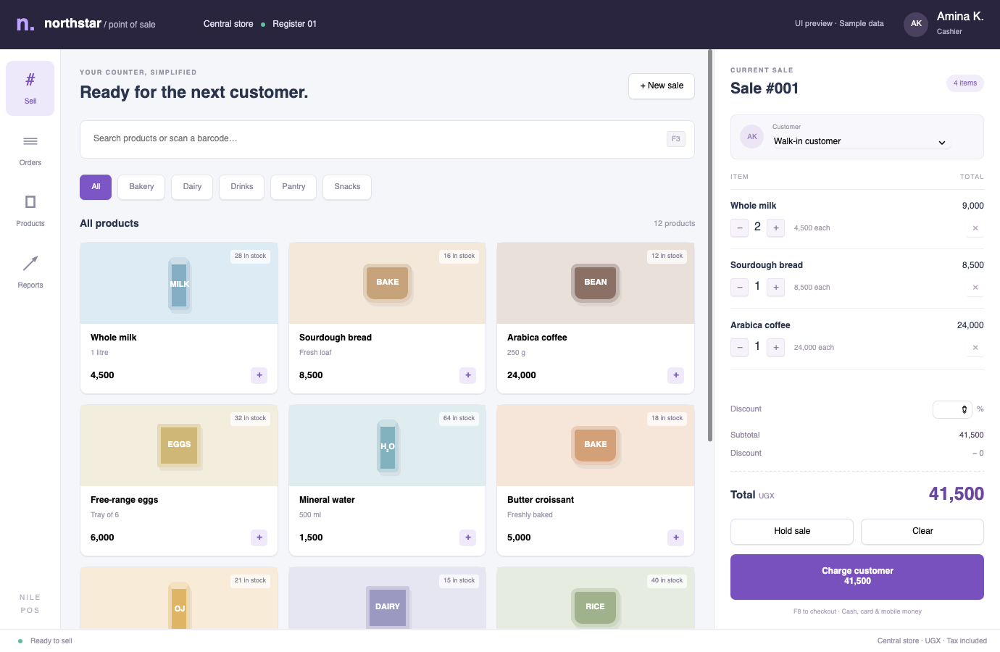
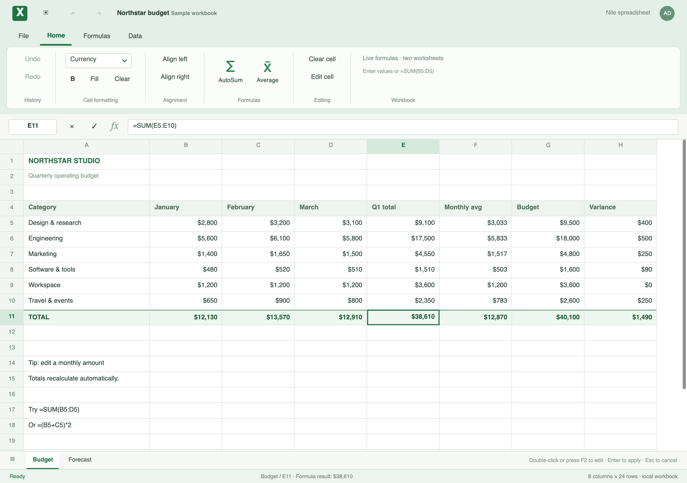
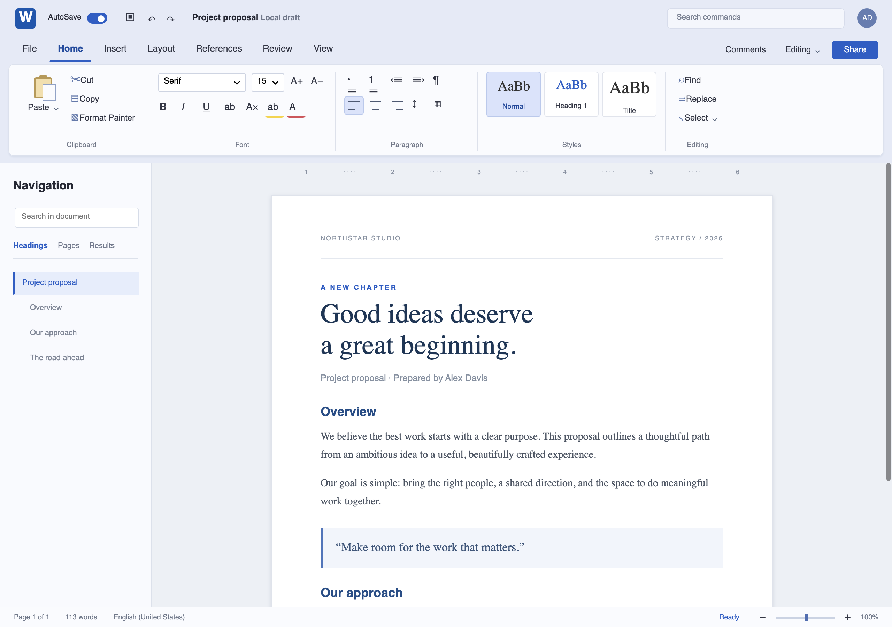
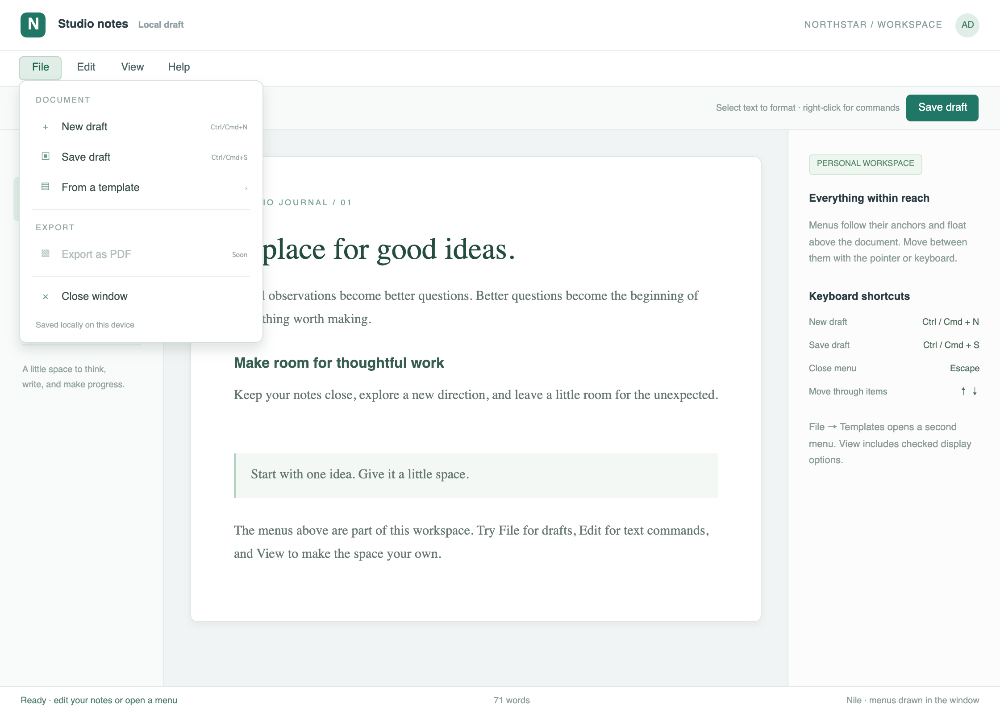

# Nile

**Build desktop apps with HTML, CSS and JavaScript, without shipping a browser.**

Nile is an open-source, embeddable UI engine written in Rust, in the spirit of
[Sciter](https://sciter.com): its own renderer (Skia), layout (Taffy), text shaping (Parley) and
JavaScript runtime (QuickJS). There is no webview and no Chromium. A packed app is one small executable, and
the same engine can be embedded in a C, C++ or Rust program that owns its own window.

[](https://github.com/hsemix/nile/actions/workflows/ci.yml)

*"nile" is a working title.*


| | |
|---|---|
|  **A retail counter**: search, cart, discounts, held sales, receipts |  **A spreadsheet**: formulas, two sheets, formatting |
|  **A word processor**: a ribbon around a live `contenteditable` page |  **A real menu bar** on macOS and Windows |

New here? Read the [usage guide](docs/guide/README.md) and [build your first app](docs/guide/getting-started.md).

## What you get

Nile is a desktop UI platform, not a layout demo. In this repository today:

**Rendering and layout**
- HTML parsing and a CSS engine with selectors, the cascade, custom properties, `@media`, `@supports`,
  `@font-face`, `@layer`, nesting and `calc()`/`clamp()`; block, inline, flex, grid, table, float, positioned and
  sticky layout; `transform` (2D and 3D), transitions and `@keyframes`, gradients, shadows, filters, blend modes,
  masks, `clip-path`, scroll snap, variable fonts, system dark mode and accent colour.
- `<canvas>` 2D, inline and file SVG, images, `<audio>`, pagination and PDF export (`@page`, repeated table headers,
  margin boxes), a paged "sheets" view, and platform-themed controls (Windows 11, macOS, Adwaita-style).

**Scripting**
- ES modules, JSX, class and function components, `customElements`, and the DOM you expect (events with
  capture/bubble, `MutationObserver`, `ResizeObserver`, `fetch`, `WebSocket`, `localStorage`, `Blob`/`FormData`,
  streams, `Intl`, `crypto.subtle`), plus Sciter's `$`/`on()`/`@sys`/`@env`/`@storage` shapes so Sciter apps can port.
- Everything blocking runs on worker threads: the window never freezes on a request, a print job or a hash.

**Forms and editing**
- Real text inputs, textareas, selects, list boxes, pickers, validation, undo, IME, drag and drop (in a page, in from
  the desktop, and files out to it), and a rich-text editor (`contenteditable` with lists, tables, images, clipboard HTML,
  undo and editing across paged sheets).

**The desktop shell**
- Windows with every `window-*` option, frameless and translucent windows, materials (Mica, vibrancy), multiple and
  modal windows, native menu bars, tray icon, dock badge and progress, global hotkeys, tooltips and popups, native
  dialogs, monitors and power state, drag files out, single-instance apps, file and URL association, login items.
- Accessibility through AccessKit (roles, names, states, text runs, selections, live regions).
- Packaging: `nile --pack` turns a folder into one executable (an `.app` on macOS) with icon and version details;
  signed content updates; start-up from the pack.

**Components and services you can import** (all optional, nothing is paid for until imported)
- `@nile/ui`: virtual data grid (100,000 rows), tree, tabs, accordion, drawer, splitter, dialogs, toasts, combobox,
  calendar and date pickers, number keypad, menus and a command palette, ribbon, wizard, charts, tiles, barcodes and QR codes.
- Printing: system printers, raw and network receipt printers, ESC/POS receipts (`@nile/print`, `@nile/escpos`).
- Hardware and OS: serial ports (`@nile/serial`), the system credential store (`@nile/keychain`), SMTP email
  (`@nile/mail`), file watching, reveal/trash/open-with, hashing and encryption (`@nile/crypto`).
- Native extensions loaded from a manifest: SQLite, and camera and microphone capture (`@media`).

**Embedding**
- A C API (`libnile`) for hosts that own the window and event loop, and `libnile_app` for hosts that don't.

About 53,000 lines of Rust, 16,000 lines of JavaScript, over 400 tests, 147 example pages and 30 guides.
The full inventory is in [What's supported](docs/reference/supported.md); what is missing is in
[Known gaps](docs/reference/known-gaps.md).

## Try it

Requires recent stable Rust. On macOS you also need the Xcode command line tools (`xcode-select --install`). The first
build downloads prebuilt Skia binaries (macOS arm64/x86_64, Windows, Linux).

```sh
cargo run -p nile-shell -- examples/hello.html                     # a window; F5 or Ctrl/Cmd+R reloads
cargo run -p nile-shell -- examples/workbench/index.html           # nine app screens
cargo run -p nile-shell -- examples/pos/index.html                 # retail counter
cargo run -p nile-shell -- examples/hello.html --png out.png       # render without a window
cargo test --workspace
```

The headless mode simulates input (`--click`, `--hover`, `--type`, `--wheel`), which is how the examples are checked:

```sh
cargo run -p nile-shell -- examples/forms.html --png out.png --click 60,66 --type "Ada{Backspace}x"
cargo run -p nile-shell -- examples/scripting.html --png out.png --click 60,80 --wait 400
```

### Demos

| Run | What it is |
|---|---|
| `examples/workbench/index.html` | Nine interfaces: settings, dashboard, kanban, mail, code studio, inventory, calendar, media library, slides ([guide](examples/workbench/README.md)) |
| `examples/pos/index.html` | Retail counter: search, categories, cart, discounts, held sales, checkout, receipts ([guide](examples/pos/README.md)) |
| `examples/excel/index.html` | Spreadsheet with formulas, two worksheets, formatting and local saving ([guide](examples/excel/README.md)) |
| `examples/word-ribbon.html` | Word-style ribbon around a rich-text editor ([guide](docs/guide/rich-text-editing.md)) |
| `examples/virtual-grid/index.html` | Up to a million rows and 100 columns, virtualised on both axes ([guide](examples/virtual-grid/README.md)) |
| `examples/file-explorer/index.html` | A real folder browser over `@sys`: tree, sortable list, previews, context menus ([guide](examples/file-explorer/README.md)) |
| `examples/register.html` | A custom title bar, tool windows and a CSS-`prototype:` serial-number input |
| `examples/printing.html`, `serial.html`, `mail.html`, `media/` | Printers and receipts, serial terminal, SMTP form, camera and microphone |
| `examples/system-theme/index.html` | An optional platform theme package ([notes](themes/system/README.md)) |

The [example catalog](docs/reference/examples.md) lists every page.

## Embed it

`libnile` (from `cargo build -p nile-capi --release`) and its generated `nile.h` let a host own the window and the event
loop: create a view, forward pointer, wheel, key and IME events, call `nile_view_tick`, and draw into your own BGRA buffer. The page talks
back through window commands, a console queue, registered host functions, clipboard and dialog callbacks, file drops
and popup windows. A program that doesn't want to write window code links `libnile_app` instead
(`nile_run`, `nile_run_file`, `nile_run_html`; `examples/c/app.c`).

```sh
cargo build -p nile-capi --release
cc examples/c/render.c -Icrates/nile-capi/include -Ltarget/release -lnile -Wl,-rpath,$PWD/target/release -o render
./render examples/hello.html out.ppm
```

Every exported function, with ownership and safety rules, is in the [native API reference](docs/reference/native-api.md).
Not in the C API yet: multiple mouse buttons, touch, GPU surfaces (it paints into CPU memory).

## Native extensions

Native packages can add operations that return Promises, binary buffers, managed resources and event streams, without
being linked into the engine: SQLite, camera and microphone capture, and a notifications example ship in `extensions/`.
An app opts in through `nile.json`; packed apps carry the native files in a verified private cache.

```sh
cargo run -p nile-extensions --example build-extension -- sqlite --dest examples/sqlite/extensions/sqlite
cargo run -p nile-shell -- examples/sqlite/index.html
```

See the [extension guide](docs/extensions.md) for the C ABI, the threading and ownership contract, and platform packaging.
Extension code is trusted, process-level code; this is not a sandbox.

## How it is built

```
HTML ──html5ever──▶ DOM ──cascade──▶ computed styles ──Taffy + Parley──▶ boxes ──Skia──▶ pixels
                     │
                     └──▶ <script> ──▶ QuickJS
```

| Crate | Job | Built on |
|---|---|---|
| `nile-dom` | Arena DOM, HTML parsing, packed-app file system | `html5ever` |
| `nile-style` | CSS parsing, cascade, inheritance, user-agent and platform themes, animation | `cssparser`, Servo `selectors` |
| `nile-text` | Shaping, line breaking, font fallback, web fonts | `parley` |
| `nile-layout` | Block, inline, flex, grid, table and float layout, pagination | `taffy` |
| `nile-render` | Backgrounds, borders, shadows, filters, text and images | `skia-safe` |
| `nile-canvas`, `nile-svg`, `nile-audio` | `<canvas>`, SVG, audio playback | Skia, `resvg`, `rodio` |
| `nile-script` | JS runtime, DOM bridge, web platform, modules, JSX, `@nile/*` libraries | `rquickjs` |
| `nile-engine` | The page without a window: input, forms, editing, scrolling, accessibility tree, painting into a buffer | |
| `nile-shell` | The `nile` binary: windows, menus, tray, dialogs, packaging, updates | `winit`, `softbuffer`, `accesskit` |
| `nile-capi`, `nile-app` | `libnile` for hosts with their own window; `libnile_app` with `nile_run` | `cbindgen` |
| `nile-extension-sdk`, `nile-extensions`, `nile-extension-pack` | Native extension C ABI, loader and packed-app cache | `libloading` |

Data flows one way (DOM, style, layout, render), and the engine has no windowing dependency, which is what makes it embeddable.

## Platform status

CI builds and runs the test suite on macOS, Windows and Linux for every push. Development happens on macOS, so
the macOS paths have been run by hand and the Windows and Linux shell code mostly has not. Each guide says what was
verified and what is only compiled.

| | macOS | Windows | Linux |
|---|---|---|---|
| Rendering, layout, scripting, forms, editing | tested | CI | CI |
| Windows, dialogs, clipboard, packaging | tested | compiled; partly run | compiled; partly run |
| Native menu bar | native | native (written blind) | in-window bar |
| Tray, badge, progress | yes | compiled, not run | no |
| Printing, keychain, global hotkeys | tested | compiled | compiled (X11 only for hotkeys) |
| Serial, camera and microphone | tested | type-checked | built in CI (not run on hardware) |

## Documentation

- **[Usage guide](docs/guide/README.md)**: tutorials from a first page to packaging, printing, accessibility, updates,
  serial, email, camera and more.
- **[Feature reference](docs/reference/README.md)**: CSS, DOM and events, web APIs, built-in modules, windows and menus,
  editing, the C API, [what's supported](docs/reference/supported.md) and [known gaps](docs/reference/known-gaps.md).
- **[Native extensions](docs/extensions.md)** and the [changelog](CHANGELOG.md).
- Compatibility with Sciter follows its documentation ([docs.sciter.com](https://docs.sciter.com)), but Nile is its own
  project and not a drop-in replacement. Nile is a desktop UI engine, not a browser: features are added for named
  desktop needs, not for web parity.

## Roadmap

Done: the whole pipeline; forms, editing, scrolling, media and canvas; paged layout and PDF; accessibility; the window
and shell features above; packaging and signed updates; the desktop services and component library above.

Next, in rough order:
1. **Installers and signing**: MSI/NSIS, DMG, AppImage/deb, macOS notarisation and Windows code signing. Waiting on
   signing credentials.
2. **Real-machine verification** of the Windows and Linux shell paths (menus, tray, printing, credential stores,
   hotkeys, camera), and a screen-reader pass.
3. **GPU surfaces**: Skia on Metal, D3D and Vulkan instead of the CPU path (paint is already about 1 ms on a large page,
   so this matters for very large windows).
4. **More desktop hardware** when an app needs it: HID, raw USB, Bluetooth LE.
5. **Language bindings** (Python, C#, Go) over the C API, once the engine coverage is where we want it.

Open CSS items (`@container`, multi-column layout, `writing-mode`, shadow DOM) are tracked in
[Known gaps](docs/reference/known-gaps.md).

## License

MIT OR Apache-2.0
